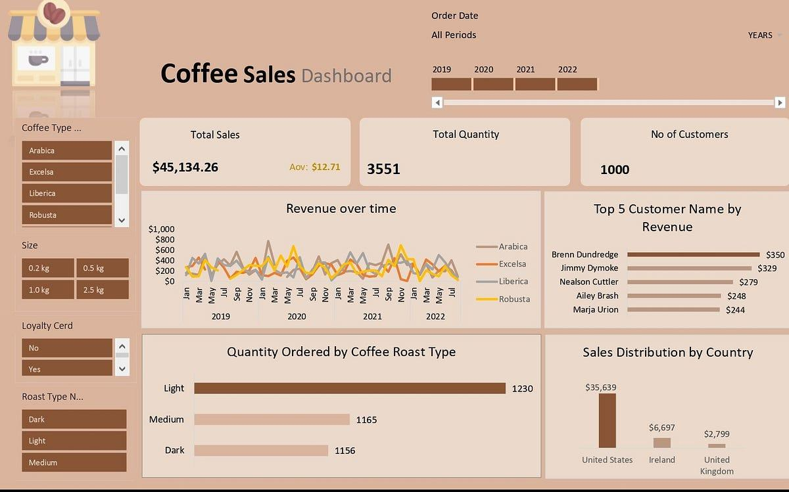

# Excel Coffee Sales Analysis

An interactive Excel dashboard to analyze coffee sales, customer performance, and sales trends across different countries.

## Dashboard Preview

## Tools Used
- Microsoft Excel
- XLOOKUP
- INDEX-MATCH
- Pivot Tables & Pivot Charts
- Slicers & Timeline

## Key Insights Analyzed
- Sales trends over time
- Country-wise sales performance
- Top 5 customers
- Coffee type and roast type analysis

## Project Files
- `coffeeOrdersData.xlsx` – Dataset
- `coffeeOrdersProject.xlsx` – Excel analysis and dashboard
- `dashboard.jpg` – Dashboard preview

